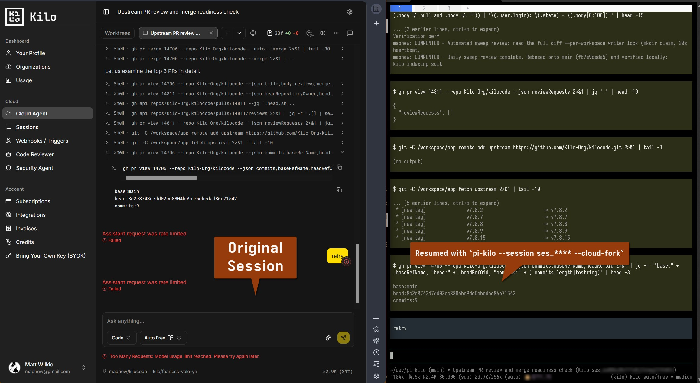

# Pi-kilo

A prototype integration of the Pi coding agent with Kilo’s shared project/session experience, so a user can move between Pi, Kilo CLI, and Kilo Cloud without losing work continuity.

The desired experience is for `app.kilo.ai` not caring which compatible runtime is executing a session. The interface shows shared conversation, and messages should reach whichever runtime currently owns execution.

This is runtime interoperability, not merely exporting a transcript or displaying a read-only copy of another agent’s session.

_A cloud session on left, resumed in pi-kilo on the right_


## What is in this repository

This is a research and prototype repository, not a packaged product. The two runnable pieces are:

- **`pi-kilo`** — moves conversations between the two runtimes. Kilo → Pi: imports a Kilo Cloud session into Pi’s session format and continues it locally. Pi → Kilo: imports Pi sessions into Kilo’s local store, with an explicit opt-in publish. See [`prototype/KiloImport.md`](prototype/KiloImport.md) and [`prototype/PiToKilo.md`](prototype/PiToKilo.md).
- **`prototype/pi_adapter.py`** — a local harness that routes a Kilo-style message to Pi over Pi’s RPC interface and proves execution ownership, message deduplication, permission enforcement, and resume behavior. See [`prototype/Demo.md`](prototype/Demo.md).

Phase 0 research and evidence live in [`reports/research/`](reports/research/). The full brief is in [`Plan.md`](Plan.md).

## Install

### Prerequisites

| Requirement | Used for | Notes |
| --- | --- | --- |
| Python 3.10+ | Both prototypes | Standard library only; no third-party Python packages. |
| [Pi](https://github.com/badlogic/pi-mono) 1.3.0+ | Importer and adapter | Must be on `PATH`, or set `PI_BIN` for the importer. |
| Node.js | Pi runtime | Pi itself is a Node application. |
| Kilo CLI | Cloud session import | Needed once for `kilo auth login`. |
| `uv` or `pipx` | Installing the `pi-kilo` command | Optional; the checkout wrapper works without either. |
| Kilo.ai account  | https://app.kilo.ai/cloud/sessions | A Kilo Gateway subscription or enough credits to use Kilo.ai user features |

Network access to `https://ingest.kilosessions.ai` is required when importing a session from Kilo Cloud.

### Install the `pi-kilo` command

From a checkout:

```bash
git clone https://github.com/maphew/pi-kilo.git
cd pi-kilo
uv tool install ./prototype
pi-kilo --help
```

Or with pipx:

```bash
pipx install ./prototype
```

The importer is installed from the checkout; it is not published to PyPI as part of this prototype. After pulling changes, reinstall with `uv tool install --force ./prototype` or `pipx install --force ./prototype`.

You can also run it without installing anything:

```bash
./prototype/pi-kilo --help
```

### Authenticate to Kilo

The importer reads your existing Kilo OAuth token; it does not implement its own login flow.

```bash
kilo auth login
```

The token is read from `~/.local/share/kilo/auth.json`. Use `--auth-file` or `KILO_AUTH_FILE` to point at a different file. The token is sent only to the configured Kilo ingest endpoint and is not written into the Pi session.

### Continue a Kilo Cloud session in Pi

```bash
# Import and immediately open the session in Pi
pi-kilo ses_eb5d6080cffeyzVSJWq1dCcInP

# Kilo-compatible spelling
pi-kilo --session ses_eb5d6080cffeyzVSJWq1dCcInP --cloud-fork

# Import into a specific project directory; flags after `--` go to pi
pi-kilo ses_eb5d6080cffeyzVSJWq1dCcInP --cwd ~/dev/project -- --model kilo/x

# Write the Pi session without launching the TUI
pi-kilo ses_eb5d6080cffeyzVSJWq1dCcInP --import-only --out /tmp/session.jsonl

# Convert a previously saved cloud export, offline
pi-kilo --export-json export.json --cwd ~/dev/project --import-only
```

By default the converted session is written to Pi’s normal session directory for `--cwd` (under `~/.pi/agent/sessions/`), so it also appears in `/resume`. Each import creates a new Pi session; importing the same Kilo session twice does not overwrite the earlier Pi session.

The imported Pi session is a new, independent session. New Pi turns are not visible to Kilo, and Pi cannot resume Kilo’s private runtime state. Re-importing creates another Pi session rather than incrementally syncing. See [`prototype/KiloImport.md`](prototype/KiloImport.md) for the full conversion table, branch/compaction behavior, and limits.

### Bring Pi sessions into Kilo

The reverse direction is local-first, mirroring Kilo’s own “local until `/remote` or `/share`” behavior:

```bash
# Convert every Pi session and import it into Kilo's local store (no network)
pi-kilo import --all

# Just the 10 most recently modified sessions
pi-kilo import --limit 10

# One project, one session, or a dry run that only writes export JSON
pi-kilo import --cwd ~/dev/project
pi-kilo import --session 164b1be58
pi-kilo import --all --dry-run --out /tmp/kilo-exports

# Opt-in: upload history for one imported session to Kilo Cloud
pi-kilo publish --list
pi-kilo publish ses_...            # prints the plan, uploads nothing
pi-kilo publish ses_... --post     # uploads history
```

Import exports are scratch files: without `--out` they are written to a temporary
directory and removed when the run finishes.

Imports run `kilo import` with `KILO_DISABLE_SESSION_INGEST=1`, so they cannot create a Cloud session or share. The result appears in Kilo’s `/resume` for that project. Publishing uploads history only; it does not attach Pi as a live executor. See [`prototype/PiToKilo.md`](prototype/PiToKilo.md).

### Run the Pi adapter harness

Configure a Pi model provider first (the demo was run with the `kilo` provider), then run from the repository root:

```bash
# Smoke test: one message is executed by Pi, then a retry is deduplicated
python3 prototype/pi_adapter.py "Reply with exactly: PONG-HIP-01"

# Full test: tool execution, permission denial, adapter kill and resume
python3 prototype/pi_adapter.py --full
```

The harness writes managed sessions under `/tmp/pi-kilo-hip/sessions/` and currently expects the Pi binary at `/home/linuxbrew/.linuxbrew/bin/pi`. Adjust `PiAdapter.start()` if your Pi lives elsewhere.

## Development

### Set up a checkout

```bash
git clone https://github.com/maphew/pi-kilo.git
cd pi-kilo
python3 -m unittest prototype/test_kilo_import.py
python3 -m unittest prototype/test_pi_to_kilo.py
```

There is no build step, `package.json`, or JavaScript dependency tree. Both converters and the adapter are plain Python; the only Pi extension is [`prototype/kilo-gate.ts`](prototype/kilo-gate.ts), which Pi loads directly for the full adapter demo.

### Tests

The converter tests (both directions) need no network, credentials, or Pi installation:

```bash
python3 -m unittest prototype/test_kilo_import.py
python3 -m unittest prototype/test_pi_to_kilo.py
```

They cover classic root turns, linked branch selection, compaction with and without a retained tail, tool/usage mapping, active-branch Pi conversion, deterministic ids, publish payloads, and session placement.

To verify an imported session with Pi without calling a model:

```bash
printf '{"id":"r1","type":"get_state"}\n' \
  | pi --mode rpc --session /tmp/session.jsonl

pi --export /tmp/session.jsonl /tmp/session.html
```

### Repository layout

| Path | Contents |
| --- | --- |
| `prototype/kilo_import.py` | Kilo Cloud export fetch and Kilo-to-Pi session conversion. |
| `prototype/pi_to_kilo.py` | Pi-to-Kilo conversion, local import, and opt-in history publish. |
| `prototype/pi-kilo` | Checkout wrapper for `kilo_import.py` / `pi_to_kilo.py`. |
| `prototype/pi_adapter.py` | Pi RPC harness for ownership, dedupe, permission, and resume probes. |
| `prototype/kilo-gate.ts` | Pi extension used by the adapter demo to gate tool calls. |
| `prototype/test_kilo_import.py` | Offline unit tests for the Kilo-to-Pi converter. |
| `prototype/test_pi_to_kilo.py` | Offline unit tests for the Pi-to-Kilo converter and publish payload. |
| `prototype/KiloImport.md` | Kilo-to-Pi usage, mapping details, evidence, and boundaries. |
| `prototype/PiToKilo.md` | Pi-to-Kilo local import, publish, mapping details, and boundaries. |
| `prototype/Demo.md` | Adapter demo script and expected output. |
| `reports/research/` | Phase 0 workstream reports, reviews, and the evidence ledger. |
| `drafts/` | Draft upstream issues for Kilo. |
| `pi-extensions/` | Pointer to the separate `@maphew/pi-beads` Pi extension. |

### Configuration

| Variable | Used by | Purpose |
| --- | --- | --- |
| `PI_BIN` | `pi-kilo` | Path to `pi` when it is not on `PATH`. |
| `KILO_BIN` | `pi-kilo import` | Path to `kilo` when it is not on `PATH`. |
| `PI_SESSIONS_DIR` | `pi-kilo import` | Override Pi’s session root (default: `~/.pi/agent/sessions`). |
| `KILO_DB` | `pi-kilo import` / `publish` | Override Kilo’s SQLite path (default: `~/.local/share/kilo/kilo.db`). |
| `KILO_AUTH_FILE` | `pi-kilo` | Override the Kilo `auth.json` location. |
| `KILO_SESSION_INGEST_URL` | `pi-kilo` | Override the Kilo session ingest base URL. |
| `PI_GATE_DENY` | `kilo-gate.ts` | Comma-separated tool-name fragments denied by default; defaults to `write,bash,edit`. |

Equivalent CLI flags (`--auth-file`, `--ingest`) take precedence for the importer.

### Research and project tracking

- **Research artifacts** follow the conventions in [`reports/research/Readme.md`](reports/research/Readme.md): dated filenames, evidence labels, repository commit/date provenance, and explicit separation of history access, bidirectional messaging, continuation, and handoff.
- **Work tracking** uses [Beads](https://github.com/gastownhall/beads). Run `bd ready`, `bd show <id>`, and `bd prime` for the project workflow.
- **This repository is swamp-managed.** Do not hand-edit the managed section of [`AGENTS.md`](AGENTS.md). Runtime state under `.swamp/` is intentionally not committed.

### Security notes

- Keep the Pi RPC boundary local. Do not expose an unauthenticated control endpoint to a network.
- Tool authorization stays in the executing runtime; the Kilo-side gate in `kilo-gate.ts` is enforced by Pi, not by the caller.
- Do not log credentials, prompts, or sensitive tool output when capturing evidence.
